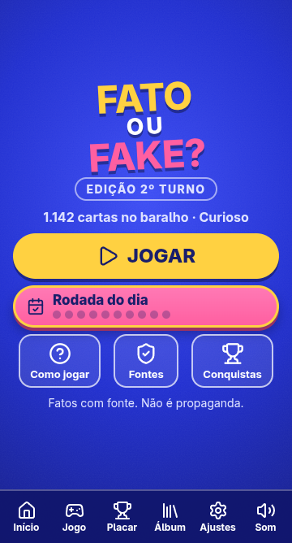
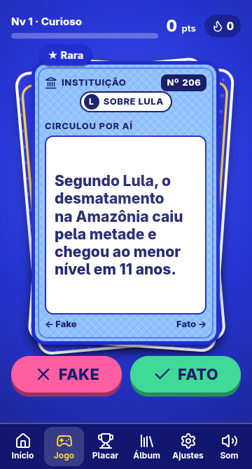
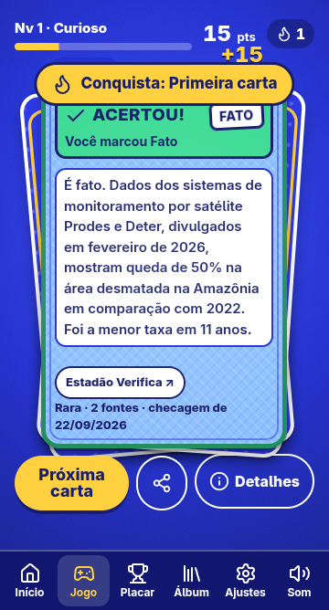
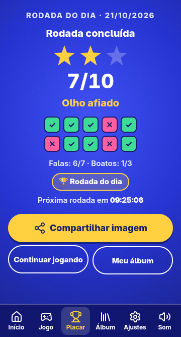
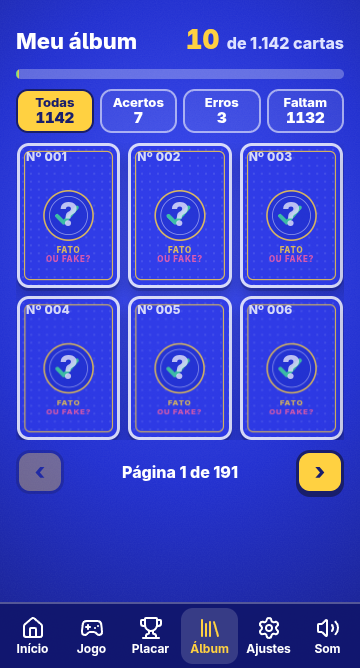

# Fato ou Fake?

**Um jogo de cartas para testar se você sabe separar fato de fake.** Você lê uma afirmação que circulou por aí, arrasta a carta para **Fato** ou **Fake** e vê o que os verificadores de fatos concluíram, com o link para a matéria original.

Edição do 2º turno de 2026: todas as cartas são sobre **Lula** e **Flávio Bolsonaro** (falas, números, boatos e vídeos que circularam sobre cada um), com o mesmo critério para os dois.

> Projeto independente, sem fins lucrativos, sem anúncios, sem cadastro e sem coleta de dados pessoais. Não tem ligação com campanha, partido ou candidato, nem com os verificadores citados.

| Início | Carta | Resposta | Rodada do dia | Álbum |
|:--:|:--:|:--:|:--:|:--:|
|  |  |  |  |  |

## Como jogar

1. **Leia a carta.** É uma afirmação que circulou: uma fala, um número, um post, um vídeo.
2. **Arraste para a direita se for fato, para a esquerda se for fake.** Ou use os botões.
3. **Confira a checagem.** Cada resposta mostra o que o verificador concluiu, em linguagem simples, e o link da matéria.
4. **Arraste de novo para qualquer lado** para ver a próxima carta.

## O que tem no jogo

- **Rodada do dia:** 10 cartas iguais para todo mundo, metade fato e metade fake, com os assuntos revezados. Termina com nota, estrelas e uma imagem para compartilhar.
- **Conquistas:** 14 selos que premiam o hábito de checar (abrir a fonte, acertar boatos, olhar os dois lados), não torcida.
- **Álbum:** as cartas viram figurinhas colecionáveis, com filtros e páginas que acompanham o dedo.
- **Pontos, níveis, sequência e raridade:** cartas com mais fontes são mais raras.
- **Trilha e efeitos sonoros** gerados no próprio aparelho (nenhum arquivo de áudio), com controle de volume.
- **Feito para o celular:** PWA que cabe na tela sem rolagem, com arrasto, vibração e modo de movimento reduzido.
- **Acessível:** meta WCAG 2.2 AA, teclado, leitor de tela, paleta para daltonismo e texto maior.

## Como as cartas são escolhidas

- Só entra carta com **classificação clara de "verdadeiro" ou "falso"** publicada por um verificador de fatos da lista da [IFCN](https://ifcncodeofprinciples.poynter.org/signatories) (hoje: Lupa, Aos Fatos e Estadão Verifica). O servidor recusa fonte fora do registro em [`server/sources.ts`](server/sources.ts).
- Algumas cartas são checagens do Projeto Comprova republicadas no Estadão Verifica. Isso aparece no campo "status" da própria carta.
- Classificações com nuance ("enganoso", "exagerado", "falta contexto", "sem provas", "tirado de contexto") **ficam de fora**, para toda carta ter uma resposta clara.
- A carta é sempre sobre o conteúdo da afirmação ("Segundo Lula, ..." ou "Post viral: ..."), com a atribuição de quem disse ou de qual post.
- O mesmo critério vale para os dois lados. Em "Fontes", o jogo mostra quantas cartas há de cada grupo, porque o baralho reflete o que os verificadores checaram, e isso não é simétrico.
- **Curadoria assistida por IA, com conferência independente:** as cartas foram levantadas e redigidas com ajuda de agentes de IA lendo as páginas dos verificadores. Depois, outros agentes reabriram cada página e conferiram veredito, atribuição, números e datas. Isso derrubou ou corrigiu centenas de cartas, mas **não substitui revisão humana**: se você achar um erro, abra uma issue.
- Os textos das cartas são resumos em linguagem simples. A palavra final é sempre da matéria do verificador, que está linkada em cada carta.

## Rodar no seu computador

Precisa de Node 22 ou mais novo.

```bash
git clone https://github.com/diegorodrigo90/fato-ou-fake.git
cd fato-ou-fake
npm ci
npm run dev          # http://localhost:3000
npm test             # testes (vitest)
npm run build && npm start
```

Variáveis de ambiente (opcionais):

| Variável | Padrão | Para quê |
|---|---|---|
| `PORT` | `3000` | Porta do servidor |
| `POOL_PATH` | `data/pool.json` | Arquivo com as cartas |
| `TRUST_PROXY` | desligado | Ligue **só** atrás de um proxy confiável (Traefik, Cloudflare), para o limite de requisições enxergar o IP real |

Também roda em Docker (`Dockerfile` multi-stage, usuário sem privilégios e `HEALTHCHECK`). O passo a passo para o Coolify está em [`docs/deploy-coolify.md`](docs/deploy-coolify.md).

## Publicar no GitHub Pages

O jogo também roda como site estático. `npm run build:pages` valida o baralho e gera `dist-pages/` (jogo, `pool.json` e `sources.json`), e o workflow [`pages.yml`](.github/workflows/pages.yml) publica a cada push na `main`. Para ligar: **Settings → Pages → Source: GitHub Actions**. Todos os caminhos são relativos, então funciona em `usuario.github.io/fato-ou-fake/`.

## Como é feito

- **Servidor:** Node 22, TypeScript, [Hono](https://hono.dev), zod e `hono-rate-limiter`. Serve o jogo e `GET /api/pool`, com CSP restrita, `nosniff`, gzip e `ETag`.
- **Jogo:** HTML, CSS e JavaScript puros, sem framework e sem etapa de build. Web Animations API, Web Audio, Pointer Events e `<dialog>`.
- **Dados:** `data/pool.json`, validado por zod a cada leitura. Uma carta com fonte fora do registro, sem classificação clara ou sem link impede o servidor de subir.
- **Testes:** vitest, para as regras do jogo (pontos, sorteio, rodada do dia, conquistas, álbum) e para o servidor.

| O quê | Onde |
|---|---|
| Cartas | `data/pool.json` |
| Fontes aprovadas e o motivo | `server/sources.ts` |
| Regras do jogo | `public/lib.js`, `public/daily.js`, `public/album.js` |
| Interface | `public/` |
| Design | [`DESIGN.md`](DESIGN.md) |
| Produto e decisões | [`PRODUCT.md`](PRODUCT.md) |

## Privacidade e segurança

- **Nenhum dado pessoal é coletado.** Sem cadastro e sem cookies. O número de acessos é contado de forma agregada pelo Cloudflare Web Analytics, que não usa cookies nem identifica quem acessa. Pontos, conquistas e a rodada do dia ficam só no `localStorage` do seu aparelho, e "Zerar progresso" apaga tudo.
- O servidor não grava IP: o limite de requisições guarda a chave só em memória, por 60 segundos.
- Encontrou uma falha de segurança? Veja [`SECURITY.md`](SECURITY.md).

## Contestar uma carta

Errou? Discorda? Abra uma [issue](../../issues/new) com o número da carta (ex.: `Nº 042`) e o link do que você encontrou. Cartas com erro são corrigidas ou removidas.

## Avisos

- As checagens e as marcas são dos verificadores citados. O jogo apenas resume e linka. Se você é responsável por uma das fontes e quer ajustar ou retirar algo, abra uma issue.
- Este é um protótipo. Não é conselho jurídico, não é pesquisa eleitoral e não pede voto em ninguém.

## Licença

O **código** está sob a licença [MIT](LICENSE). O **conteúdo das cartas** é composto de resumos de checagens de terceiros e continua sujeito aos termos dos respectivos verificadores; não é coberto pela licença do código.
